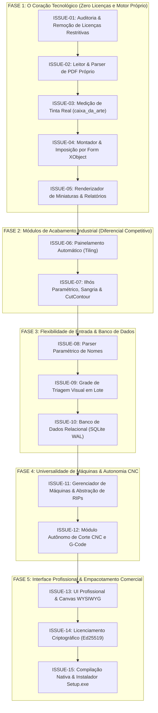

# Ordem de Execução e Roadmap das Issues — Sistema Autônomo de Produção Gráfica

Este documento define a **ordem cronológica exata e as dependências** entre as issues para transformar o `etiquetas_python` em um produto de software comercial 100% autônomo, sem dependências de licenças restritivas (PyMuPDF/AGPL, pystray/LGPL, etc.) e operando de forma totalmente independente do `CNC CAM C++` (embora possa ler o repositório como base de código e exemplo arquitetural).

---

## 1. Visão Geral das Fases de Execução

---

## 2. Tabela Detalhada com a Ordem de Numeração

| Ordem | Issue ID | Título da Issue | Dependência | Impacto Comercial / Técnico |
|:---:|---|---|---|---|
| **1º** | [**ISSUE-01**](file:///c:/Users/flavi/Desktop/etiquetas_python/docs/issues/ISSUE-01-auditoria-licencas-eliminacao-agpl-terceiros.md) | **Auditoria de Licenças e Eliminação de Dependências Restritivas** | Nenhuma | Limpa impedimentos jurídicos imediatos (`pystray`, Adobe COM, Aspire). |
| **2º** | [**ISSUE-02**](file:///c:/Users/flavi/Desktop/etiquetas_python/docs/issues/ISSUE-02-motor-pdf-proprio-leitor-parser.md) | **Motor Próprio de Leitura de PDF (Parser ISO 32000)** | ISSUE-01 | Lê sintaxe PDF, XRef e descompacta Flate/zlib nativamente (sem PyMuPDF). |
| **3º** | [**ISSUE-03**](file:///c:/Users/flavi/Desktop/etiquetas_python/docs/issues/ISSUE-03-motor-pdf-medicao-caixa-de-tinta.md) | **Medição de Caixa de Tinta Vetorial sem Rasterização** | ISSUE-02 | Calcula `caixa_da_arte` precisa eliminando franjas de 1pt sem estourar RAM. |
| **4º** | [**ISSUE-04**](file:///c:/Users/flavi/Desktop/etiquetas_python/docs/issues/ISSUE-04-motor-pdf-imposicao-form-xobject.md) | **Motor Próprio de Imposição por Form XObject** | ISSUE-03 | Monta bobinas e chapas em <500ms preservando 100% dos bytes originais. |
| **5º** | [**ISSUE-05**](file:///c:/Users/flavi/Desktop/etiquetas_python/docs/issues/ISSUE-05-motor-pdf-miniaturas-e-relatorios.md) | **Renderizador de Miniaturas e Gerador de Relatórios** | ISSUE-04 | Gera prévias rápidas e PDFs de OS / Romaneio com zero dependência AGPL. |
| **6º** | [**ISSUE-06**](file:///c:/Users/flavi/Desktop/etiquetas_python/docs/issues/ISSUE-06-modulo-acabamento-tiling-painelamento.md) | **Painelamento Automático de Grandes Formatos (Tiling)** | ISSUE-04 | Fatiamento de lonas gigantes com sobreposição de solda e marcas guia. |
| **7º** | [**ISSUE-07**](file:///c:/Users/flavi/Desktop/etiquetas_python/docs/issues/ISSUE-07-modulo-acabamento-ilhos-sangria-corte.md) | **Ilhós Paramétrico, Sangria Automática e CutContour** | ISSUE-04 | Miras de prensagem, espelhamento de borda e vetor para mesas digitais. |
| **8º** | [**ISSUE-08**](file:///c:/Users/flavi/Desktop/etiquetas_python/docs/issues/ISSUE-08-desacoplamento-entrada-parser-parametrico.md) | **Desacoplamento da Entrada e Parser de Nomes Paramétrico** | Nenhuma | Permite que qualquer gráfica configure seu padrão de nomenclatura (Regex). |
| **9º** | [**ISSUE-09**](file:///c:/Users/flavi/Desktop/etiquetas_python/docs/issues/ISSUE-09-painel-triagem-visual-em-lote.md) | **Grade de Triagem Visual em Lote para Arquivos Sem Padrão** | ISSUE-05, ISSUE-08 | Interface ultrarrápida para atribuir medidas e materiais em segundos. |
| **10º** | [**ISSUE-10**](file:///c:/Users/flavi/Desktop/etiquetas_python/docs/issues/ISSUE-10-banco-dados-relacional-sqlite.md) | **Banco de Dados Relacional Embutido (SQLite WAL)** | Nenhuma | Elimina perdas do OneDrive e locks manuais; garante histórico transacional. |
| **11º** | [**ISSUE-11**](file:///c:/Users/flavi/Desktop/etiquetas_python/docs/issues/ISSUE-11-gerenciador-maquinas-abstracao-rips.md) | **Gerenciador de Máquinas e Abstração de RIPs** | ISSUE-10 | Configuração em tela de impressoras e hot folders (Mimaki, SAi, Onyx, Caldera). |
| **12º** | [**ISSUE-12**](file:///c:/Users/flavi/Desktop/etiquetas_python/docs/issues/ISSUE-12-modulo-autonomo-corte-cnc-gcode.md) | **Módulo Autônomo de Corte CNC e Gerador de G-Code** | Nenhuma | Elimina o Aspire; gera percursos diretamente ou exporta para o CNC CAM. |
| **13º** | [**ISSUE-13**](file:///c:/Users/flavi/Desktop/etiquetas_python/docs/issues/ISSUE-13-interface-profissional-canvas-wysiwyg.md) | **Interface Profissional PySide6 e Canvas Interativo WYSIWYG** | Fases 1 a 4 | Visualizador acelerado a 60 FPS com arrasto e rotação manual de peças. |
| **14º** | [**ISSUE-14**](file:///c:/Users/flavi/Desktop/etiquetas_python/docs/issues/ISSUE-14-licenciamento-criptografico-ed25519.md) | **Sistema de Licenciamento Criptográfico Autônomo** | Nenhuma | Proteção por Hardware ID e assinatura Ed25519 (modelo Monocypher). |
| **15º** | [**ISSUE-15**](file:///c:/Users/flavi/Desktop/etiquetas_python/docs/issues/ISSUE-15-compilacao-nativa-instalador-setup.md) | **Compilação Nativa e Instalador Executável (Setup.exe)** | Todas | Gera instalador de 1 clique via Inno Setup sem expor código ou Python. |

---

## 3. Estratégia de Não Acoplamento com o CNC CAM

O sistema de produção gráfica deve ser um **produto independente**:
1. **Autonomia:** O cliente que compra o sistema de automação gráfica não precisa instalar nem rodar o `CNC CAM C++`. O programa roda sozinho.
2. **Uso como Base e Exemplo:** Nosso time pode consultar e reaproveitar os conceitos matemáticos e de código já consolidados no CNC CAM:
   - O parser sintático de PDF (`src/io/pdf_vector.cpp`).
   - O esquema de geração e validação de licenças com criptografia assimétrica (`third_party/monocypher` e `tools/license_tool`).
   - Os padrões de tema e interface com aceleração de renderização Qt/OpenGL.
3. **Interoperabilidade Amigável:** Para clientes que possuem **ambos** os softwares (o de automação gráfica e o CNC CAM), o sistema gera um arquivo de troca direta (como DXF estruturado ou projeto CNC) que abre com um clique no CNC CAM, sem forçar essa dependência para quem usa outras fresas.
